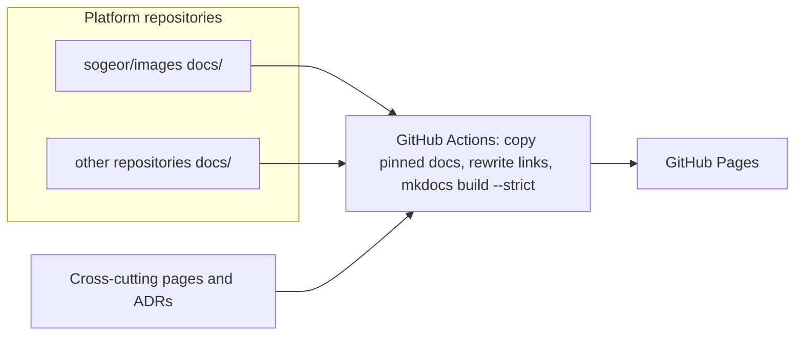

# sogeor docs

End-to-end documentation of the sogeor DevSecOps platform and the source of its documentation site.

[](https://github.com/sogeor/docs/actions/workflows/validate.yml)
[](https://github.com/sogeor/docs/actions/workflows/docs.yml)
[](https://scorecard.dev/viewer/?uri=github.com/sogeor/docs)
[](LICENSE)
[](https://github.com/sogeor/docs/releases)

## Overview

- Cross-cutting pages: platform overview, principles, cluster constructor, network, security, compliance, capacity.
- "Deploy everything": one guide from an empty account to a working platform.
- Platform ADRs ([MADR](https://adr.github.io/madr/)), runbooks, threat models, postmortems and exercises.
- Aggregates the `docs/` directory of every platform repository, pinned by tag and SHA.
- Builds and publishes the site to GitHub Pages: <https://sogeor.github.io/docs/>.

## How it works



## Quick start

```bash
git clone https://github.com/sogeor/docs.git
cd docs
pip install --require-hashes -r .github/requirements-docs.txt
mkdocs serve
```

## Documentation

The site structure, guides and reference pages are being built; see the [roadmap](ROADMAP.md).

## Versions

| Tool | Version |
|---|---|
| Python | 3.12 |
| pre-commit-hooks | 6.0.0 |
| gitleaks | 8.30.1 |
| shellcheck | 0.11.0 |
| yamllint | 1.38.0 |
| markdownlint-cli2 | 0.23.3 |
| actionlint | 1.7.12 |
| zizmor | 1.30.1 |

## Contributing

See [CONTRIBUTING.md](CONTRIBUTING.md), [GOVERNANCE.md](GOVERNANCE.md) and [CODE_OF_CONDUCT.md](CODE_OF_CONDUCT.md).

## Security

Report vulnerabilities privately as described in [SECURITY.md](SECURITY.md).

## License

[Apache-2.0](LICENSE)
