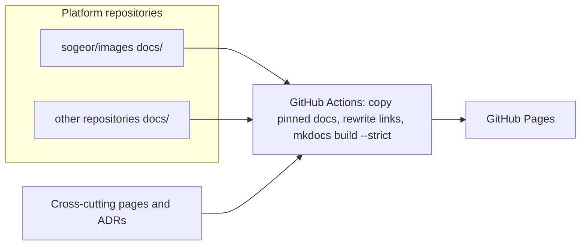

# sogeor docs

End-to-end documentation of the sogeor DevSecOps platform and the source of its documentation site.

[](https://github.com/sogeor/docs/actions/workflows/validate.yml)
[](https://github.com/sogeor/docs/actions/workflows/docs.yml)
[](https://scorecard.dev/viewer/?uri=github.com/sogeor/docs)
[](LICENSE)
[](https://github.com/sogeor/docs/releases)

## Overview

- Cross-cutting pages: platform overview, principles, cluster constructor, network, security, compliance, capacity.
- "Deploy everything": one guide from an empty account to a working platform.
- Platform ADRs ([MADR](https://adr.github.io/madr/)), runbooks, threat models, postmortems and exercises.
- Aggregates the `docs/` directory of every platform repository, pinned by tag and SHA.
- Builds and publishes the site to GitHub Pages: <https://docs.sogeor.com/>.

## How it works



## Quick start

```bash
git clone https://github.com/sogeor/docs.git
cd docs
pip install --require-hashes -r .github/requirements-docs.txt
python tools/aggregate.py
mkdocs serve -f mkdocs.generated.yml
```

`tools/aggregate.py` fetches the pinned `docs/` of every repository listed in `sources.yaml`.
Use `--local images=../images` to preview a local checkout instead. Details: [Getting started](docs/about/getting-started.md).

## Documentation

| Page | Contents |
|---|---|
| [Overview](docs/index.md) | What the platform is, where to start, repositories |
| [Platform overview](docs/platform-overview.md) | Loops, dependency rule, reference clusters, failure model, stack |
| [Vision and roadmap](docs/vision.md) | Long-term direction: sogeor platform as a multi-provider PaaS |
| [Principles](docs/principles.md) | Principles and repository conventions |
| [Cluster constructor](docs/constructor.md) | Cluster description, distributions, OS, providers, topology, sizes, validations, node contract |
| [Deploy everything](docs/deploy-everything.md) | End-to-end deployment path |
| [Network](docs/network.md) | Sites, CIDRs, mesh, inbound traffic, DNS and TLS |
| [Security](docs/security.md) | Supply chain, policies, secrets, access, detection, vulnerability management |
| [Compliance](docs/compliance.md) | International and Russian tracks |
| [Capacity](docs/capacity.md) | Sizing and budget |
| [Decisions](docs/adr/index.md) | Platform ADRs |
| [Runbooks](docs/runbooks/index.md) | Cross-repository operational procedures |
| [Incident response](docs/runbooks/incident-response/index.md) | Process, severity, playbooks |
| [Threat models](docs/threat-models/index.md) | STRIDE models of components and flows |
| [Postmortems](docs/postmortems/index.md) | Blameless incident reviews |
| [Exercises](docs/exercises/index.md) | Restore drills, chaos experiments, tabletop exercises |
| [About this repository](docs/about/index.md) | Getting started, setup, configuration, usage, operations, architecture, security, troubleshooting, reference |

## Versions

| Tool | Version |
|---|---|
| Python | 3.12 |
| MkDocs Material | 9.7.7 |
| PyYAML | 6.0.3 |
| pre-commit-hooks | 6.0.0 |
| gitleaks | 8.30.1 |
| shellcheck | 0.11.0 |
| yamllint | 1.38.0 |
| markdownlint-cli2 | 0.23.3 |
| actionlint | 1.7.12 |
| zizmor | 1.30.1 |
| sogeor/workflows (`docs`) | 0.1.1 |
| actions/checkout | 7.0.1 |
| actions/configure-pages | 6.0.0 |
| actions/upload-pages-artifact | 5.0.0 |
| actions/deploy-pages | 5.0.1 |
| actions/upload-artifact | 7.0.2 |
| github/codeql-action | 4.38.3 |
| ossf/scorecard-action | 2.4.4 |

## Contributing

See [CONTRIBUTING.md](CONTRIBUTING.md), [GOVERNANCE.md](GOVERNANCE.md) and [CODE_OF_CONDUCT.md](CODE_OF_CONDUCT.md).

## Security

Report vulnerabilities privately as described in [SECURITY.md](SECURITY.md).

## License

[Apache-2.0](LICENSE)
