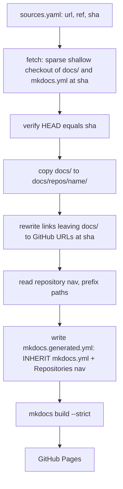

# Architecture

## Build pipeline

The approach and its alternatives are recorded in
[ADR 0001](../adr/0001-aggregate-repository-docs-via-ci-copy.md).

## Components

| Component | Responsibility |
|---|---|
| `sources.yaml` | The only list of aggregated repositories and their pins |
| `tools/aggregate.py` | Fetch, verify, copy, rewrite, generate configuration |
| `mkdocs.yml` | Base site: theme, extensions, navigation of own pages |
| `mkdocs.generated.yml` | Build configuration; generated, not committed |
| `tests/` | Unit tests of the aggregation tool |
| `.github/workflows/` | Checks, publishing, Scorecard |

## Link rewriting

Pages of a repository may link anywhere inside that repository. Inside the site only `docs/` exists, so:

| Link in `<repo>/docs/<page>` | Result |
|---|---|
| Inside `docs/` (`setup.md`, `../index.md` from `adr/`) | unchanged |
| External (`https://…`, `mailto:`), anchors (`#…`), absolute (`/…`) | unchanged |
| A file outside `docs/` (`../README.md`) | `https://github.com/<owner>/<repo>/blob/<sha>/README.md` |
| A directory outside `docs/` (`../tests`) | `https://github.com/<owner>/<repo>/tree/<sha>/tests` |
| Outside the repository (`../../x`) | build error |

Fenced code blocks and inline code are not changed. Both inline links and reference definitions are handled.

## Interfaces with other repositories

An aggregated repository must provide `docs/` that builds with MkDocs Material in strict mode and should
provide `mkdocs.yml` with `nav`. It must not use MkDocs plugins that this site does not install.
