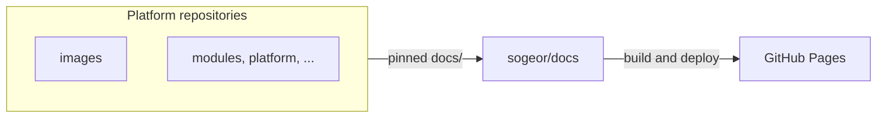

# About this repository

[`sogeor/docs`](https://github.com/sogeor/docs) is the source of this site. It holds the cross-cutting
documentation of the platform and builds one site from it and from the `docs/` directory of every platform
repository.

| It contains | It does not contain |
|---|---|
| Platform overview, principles, constructor, network, security, compliance, capacity | Documentation of a single repository (it lives in that repository) |
| Platform ADRs | Repository-level ADRs |
| Runbooks, incident response, threat models, postmortems, exercises | Code of platform components |
| The aggregation tool and site configuration | Copies of aggregated pages (they are generated at build time) |

## Place in the platform

## Pages about this repository

| Page | Contents |
|---|---|
| [Getting started](getting-started.md) | Build and preview the site locally |
| [Repository setup](setup.md) | GitHub settings, Pages, Renovate, Scorecard |
| [Configuration](configuration.md) | `sources.yaml`, `mkdocs.yml`, tool options |
| [Usage](usage.md) | Add a page, an ADR, a runbook or a repository |
| [Operations](operations.md) | Update pins, lock files, publish, roll back |
| [Architecture](architecture.md) | Build pipeline and link rewriting |
| [Security](security.md) | What the site build guarantees |
| [Troubleshooting](troubleshooting.md) | Symptom → cause → fix |
| [Reference](reference/aggregate.md) | Aggregation tool and workflows |
