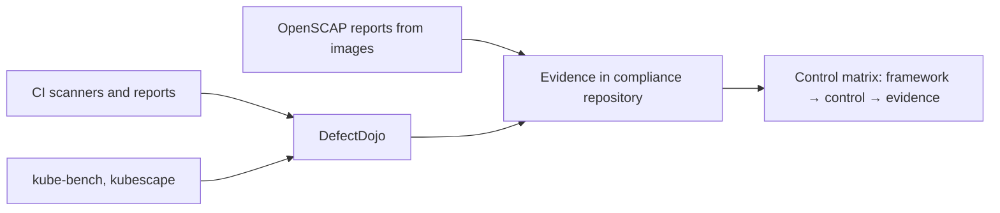

# Compliance

The platform maintains two compliance tracks. Controls, mappings and evidence live in the `compliance`
repository; regulatory texts are referenced, never copied.

## International track

| Framework | Scope |
|---|---|
| CIS Benchmarks | Operating systems (OpenSCAP), Kubernetes (kube-bench) |
| NSA/CISA Kubernetes Hardening Guide | Cluster configuration (kubescape) |
| MITRE ATT&CK | Detection rules (Falco, Sigma) |
| NIST SSDF (SP 800-218) | Development process |
| SLSA | Build provenance and supply chain |
| OWASP SAMM, ASVS Level 2 | Development maturity, the `store` application |

## Russian track

| Framework | Scope |
|---|---|
| Astra Linux SE pool, profile `astra` | Mandatory integrity control, closed software environment: what is enabled and why |
| GOST TLS demo | Optional profile `ru-track` |
| GOST R 56939-2024 | Secure software development process |
| FSTEC orders No. 17, 21, 239 | Information system protection measures |
| FSTEC vulnerability database (BDU) | Enrichment of vulnerability findings |
| Domestic security tools | Integration points (SIEM over Syslog CEF, disabled CI templates for domestic scanners) |

## Personal data

The `store` application processes personal data of Russian citizens; it is stored and processed in Russia
(152-FZ), encrypted in the database and in backups. Payments go through a payment provider only; card data
never passes through the platform (PCI DSS SAQ A scope).

## How evidence is produced

