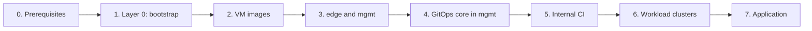

# Deploy everything

The end-to-end path from empty accounts to a working platform. Each step points to the repository that
owns it; steps whose repository is not released yet are marked **planned**.

| Step | Repository | Status |
|---|---|---|
| 1. Layer 0 | `bootstrap` | planned |
| 2. VM images | [`images`](https://github.com/sogeor/images) | ready for Ubuntu 24.04 on Proxmox |
| 3. `edge` and `mgmt` | `management`, `modules` | planned |
| 4. GitOps core | `platform` | planned |
| 5. Internal CI | `platform` (profile `ci`), `ci-templates` | planned |
| 6. Workload clusters | `modules`, `platform` | planned |
| 7. Application | `store`, `charts` | planned |

## 0. Prerequisites

**Goal:** accounts and tools ready.

1. A GitHub organization (or account) to fork the repositories into.
2. A gitlab.com account with an empty project for OpenTofu state.
3. A Cloudflare account with your domain.
4. A cloud account (Selectel or any OpenStack provider), and optionally a host with Proxmox VE.
5. A small VDS with a public address for `edge`.
6. A password manager for the state passphrase, the age key and OpenBao unseal keys.

**Verify:** you can sign in to each account and create an API token.

## 1. Layer 0: bootstrap

**Goal:** everything that cannot be created without CI and state: hypervisor network and VM, Proxmox API
users and roles, cloud projects and service users, buckets, the age key and SOPS-encrypted bootstrap secrets.

Follow the `bootstrap` repository guide (planned).

## 2. VM images

**Goal:** templates for every (OS, provider) pair used by your clusters.

Follow [images: Getting started](https://github.com/sogeor/images/blob/master/docs/getting-started.md).
Talos images come from Talos Image Factory using the schematic in `images`.

**Verify:** the template list shows the expected `<os>-<kind>-v<build>` names.

## 3. `edge` and `mgmt`

**Goal:** the mesh coordinator on `edge` and the Talos management cluster, created by GitHub Actions with
state on gitlab.com.

Follow the `management` repository guide (planned).

## 4. GitOps core in `mgmt`

**Goal:** Argo CD bootstraps itself, then installs profile `core`, OpenBao, Keycloak, Harbor, SeaweedFS,
Cluster API providers and Cluster Autoscaler.

Follow the `platform` repository guide (planned). Initialize and unseal OpenBao; store unseal keys offline.

## 5. Internal CI

**Goal:** GitLab and GitLab Runner in `mgmt`, mirrored repositories, CI templates.

## 6. Workload clusters

**Goal:** add a cluster description to Git; CAPI creates nodes and Argo CD installs components.

## 7. Application

**Goal:** `store` deployed to workload clusters through signed, verified images.

## Tear down

Reverse order: workload clusters → `mgmt` (final backups to object storage) → `edge` (optional).
See [Platform overview: Lifecycle](platform-overview.md#lifecycle).
