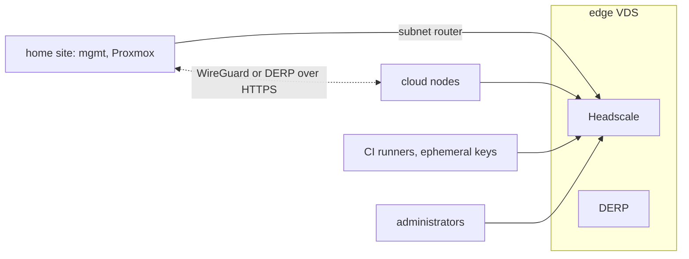

# Network

## Sites

| Site | Network | Notes |
|---|---|---|
| `home` | a private NAT network on the hypervisor host, for example `198.51.100.0/24` | No inbound ports |
| `selectel-<region>` and other clouds | provider private networks | Inbound closed except mesh and application load balancers |
| mesh | `100.64.0.0/10` (Headscale) | Connects sites |

### Home address plan

Offsets inside the home network; the network itself is a variable.

| Host part | Purpose |
|---|---|
| `.1` | Hypervisor host, gateway |
| `.10` | Proxmox VE |
| `.30`–`.39` | `mgmt` (`.30` is the API VIP in `ha`, `.31+` are nodes) |
| `.40`–`.69` | Workload pools on Proxmox (Astra and experiments) |
| `.250`–`.254` | Temporary Packer build VMs |

## Cluster CIDRs

For a cluster with `cluster_id = N` (1–24): pods `10.{10N}.0.0/16`, services `10.{10N+1}.0.0/16`.
Ranges never overlap, which ClusterMesh requires.

| Cluster | `cluster_id` | Pods | Services |
|---|---|---|---|
| `mgmt` | 1 | `10.10.0.0/16` | `10.11.0.0/16` |
| `main` | 2 | `10.20.0.0/16` | `10.21.0.0/16` |
| `talos` | 3 | `10.30.0.0/16` | `10.31.0.0/16` |

## Mesh

- **Headscale + DERP** on `edge` (a VDS with a public address, size `xs`), managed by the external loop.
- ACLs as code in `management`; tags `tag:mgmt`, `tag:main`, `tag:talos`, `tag:edge`, `tag:ci`, `tag:admin`; minimal grants.
- The Tailscale client runs on nodes outside `home` and on CI runners (ephemeral keys). A `mgmt` node or the Proxmox host is the subnet router for the home network.
- **Talos:** KubeSpan between nodes of one cluster; Tailscale system extension to other sites.
- Pod traffic encryption: Cilium WireGuard (kubeadm, k3s), KubeSpan (Talos).
- **If WireGuard is blocked:** DERP over HTTPS is the built-in fallback; AmneziaWG is plan B.

## Inbound traffic

- Services are published only through **Cloudflare Tunnel** (`cloudflared` in each cluster, replicas by topology). There are no public LoadBalancer services.
- Only Cloudflare Tunnel (public hostnames) and DNS are used. Zero Trust (Access, WARP), WAF and features that require a payment card are not used.
- Web applications: Tunnel + **oauth2-proxy (Keycloak)**. The `store` application is public, behind ingress-nginx with ModSecurity and OWASP CRS.
- Administrative access only over the mesh (`tag:admin`). The Kubernetes API, OpenBao, GitLab and Argo CD are never published to the internet.

## Nodes exposed to the internet

The `hardening` role with profile `internet` (`byo` servers, cloud nodes with public addresses, `edge`):
nftables (inbound only mesh/DERP; on `edge` also Headscale HTTPS), CrowdSec, SSH only with OpenBao SSH CA
certificates and only over the mesh, `PermitRootLogin no`, automatic security updates, auditd, AIDE.

## DNS and TLS

The reference uses the organization domain; replace it with yours.

| Zone | Where | Purpose |
|---|---|---|
| `example.com` | Cloudflare | Public organization domain |
| `docs.example.com` | GitHub Pages | Documentation site |
| `lab.example.com` | Headscale split DNS | Internal node names `<host>.lab.example.com` |
| `<cluster>.lab.example.com` | split DNS → internal ingress | Internal services, for example `argocd.mgmt.lab.example.com` |
| `store.example.com` | Cloudflare Tunnel → `prod` ingress | Online store |
| `*.apps.example.com` | Cloudflare Tunnel | Public applications, staging and review environments |

TLS: cert-manager with Let's Encrypt **DNS-01 through Cloudflare**; the internal CA is OpenBao PKI.
Disabling TLS verification is allowed only with a `TODO(tls)` marker and a tracking issue.
