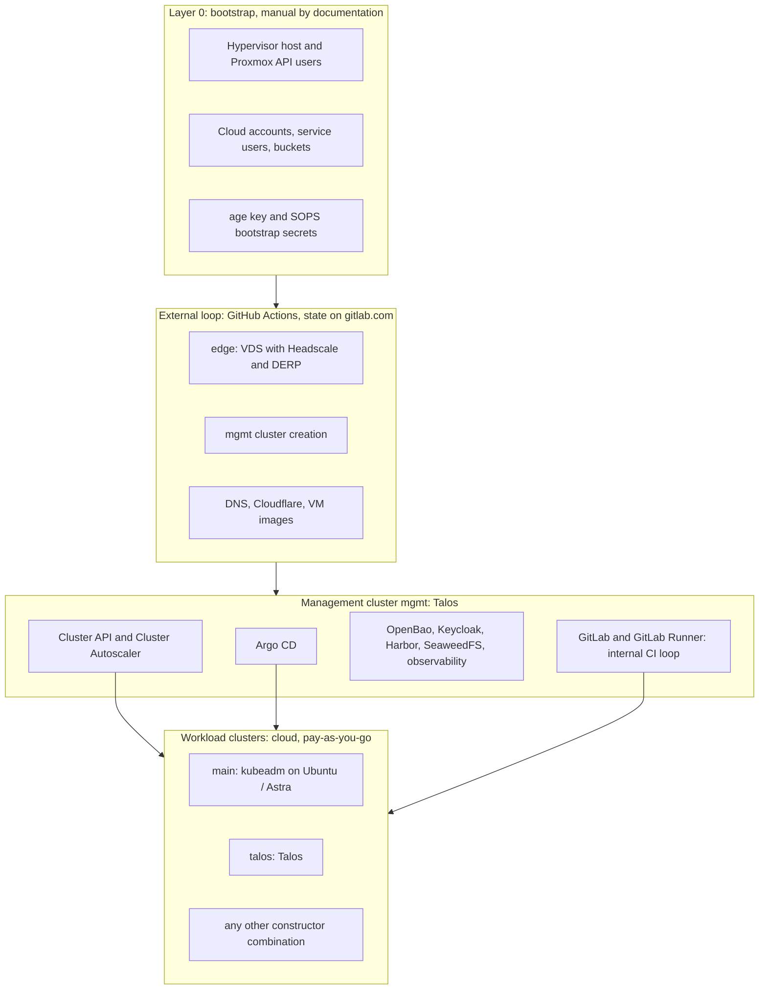

# Platform overview

## Loops

The platform is split into loops. Each loop is managed by the one above it and never manages it back.

## Dependency rule

> The management system does not depend on the infrastructure it manages.

- The external loop (GitHub Actions and gitlab.com) creates `edge` and `mgmt` and does not depend on `mgmt`.
- `mgmt` creates and maintains workload clusters; workload clusters never manage `mgmt`.
- GitLab in `mgmt` manages workload clusters, not `mgmt`.
- OpenTofu state of `edge` and `mgmt` lives on gitlab.com; state of workload clusters (when OpenTofu is used) lives in SeaweedFS in `mgmt`.

## Reference clusters

These are constructor configurations, not hard-coded clusters. Any of them can be changed, and new ones added.

| Cluster | Distribution | OS | Where | Mechanism | Topology now | Purpose |
|---|---|---|---|---|---|---|
| `mgmt` | Talos | `talos` | Proxmox, later also cloud | OpenTofu (`siderolabs/talos`) | `single` | GitOps, CAPI, secrets, registry, CI, backups |
| `main` | kubeadm | `ubuntu-2404` / `ubuntu-2604` + `astra-18` | Selectel (+ Proxmox for Astra) | CAPI | `single` | Classic stack, CIS-hardened OS, Russian track |
| `talos` | Talos | `talos` | Selectel | CAPI | `single` | Immutable approach, international track |

The `store` application is deployed to `main` and `talos` at the same time (Argo CD ApplicationSet by
cluster labels), connected by Cilium ClusterMesh when both exist.

## Failure model

| Topology | Survives | Does not survive | Recovery |
|---|---|---|---|
| `mgmt` `single` at home | pod and node restarts | loss of the host | workload clusters keep running without GitOps, secret rotation and backups; `mgmt` is recreated from Git and backups in R2 |
| `mgmt` `ha` (home + cloud, KubeSpan) | loss of one node or site | loss of the control plane majority | automatic |
| workload `single` | pod restarts | loss of the node | CAPI recreates the node; data restored from backup |
| workload `ha` | loss of a node or zone | loss of the region | automatic / recreate in another region |

!!! warning "Honest limits"
    Several nodes on one physical host are not high availability. `ha` is meaningful only across hosts or sites.

## Lifecycle

- **Tear down a workload cluster:** final backup → remove the `Cluster` object from Git → CAPI deletes all VMs and disks.
- **Bring it back:** restore the `Cluster` in Git → CAPI creates nodes → Argo CD installs components → data is restored from backups.
- **Tear down everything:** workload clusters → `mgmt` (final backups to R2) → `edge` (optional). Deployment is the reverse order.

## Technology stack

| Area | Tools |
|---|---|
| IaC | OpenTofu, tflint, Checkov, Conftest, terraform-docs |
| Cluster API | CAPI core, CAPO (OpenStack), CAPMOX (Proxmox), Talos and kubeadm bootstrap/control plane providers, k3s (community), Cluster Autoscaler |
| VM images | Packer, Talos Image Factory |
| Configuration | ansible-core, Molecule, ansible-lint |
| Kubernetes | Talos, kubeadm + containerd, k3s |
| Network | Cilium, Headscale + Tailscale, KubeSpan, cloudflared, CrowdSec |
| GitOps | Argo CD, Argo Rollouts |
| Secrets and PKI | OpenBao, External Secrets Operator, cert-manager, SOPS + age |
| Identity | Keycloak, oauth2-proxy |
| Storage | local-path-provisioner, cloud CSI, Longhorn, CloudNativePG, SeaweedFS, Velero |
| CI | GitHub Actions, GitLab CE, GitLab Runner |
| Registry | Harbor |
| Observability | VictoriaMetrics, vmalert, Alertmanager, Grafana, Loki, Vector, Tempo, OpenTelemetry Collector, Sloth |
| Security | Kyverno, Falco, Tetragon, kube-bench, kubescape, Trivy Operator, OpenSCAP, DefectDojo, Dependency-Track |
| Application | Java 21, Spring Boot 3, PostgreSQL, Kafka (Strimzi) |
