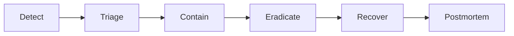

# Incident response

How security and availability incidents are handled. Playbooks follow the
[playbook template](template.md) and are mapped to MITRE ATT&CK where applicable.

## Process

| Phase | What happens |
|---|---|
| Detect | Alert from Falco, Tetragon, audit logs, CrowdSec, vulnerability SLA or a report |
| Triage | Confirm, assign severity, open an incident record |
| Contain | Isolate the workload, node, credential or network path |
| Eradicate | Remove the cause: rotate secrets, rebuild nodes from images, patch |
| Recover | Restore service from Git and backups, verify |
| Postmortem | Blameless [postmortem](../../postmortems/index.md) within 5 working days |

## Severity

| Severity | Definition | Response |
|---|---|---|
| SEV1 | Data exposure, compromise of `mgmt`, OpenBao or signing keys, `store` production down | Immediately |
| SEV2 | Compromise of a workload node or credential, degraded production | Within 4 hours |
| SEV3 | Suspicious activity without confirmed impact, staging outage | Next working day |

## Playbooks

| Playbook | ATT&CK | Status |
|---|---|---|
| Leaked credential or token | T1552 Unsecured Credentials | planned |
| Compromised container | T1611 Escape to Host | planned |
| Unsigned or unverified image admitted | T1525 Implant Internal Image | planned |
| Suspicious access to OpenBao | T1555 Credentials from Password Stores | planned |
| Break-glass kubeconfig used | T1078 Valid Accounts | planned |
| Unexpected outbound traffic | T1041 Exfiltration Over C2 Channel | planned |
