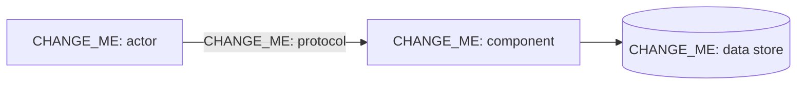

# Threat model template

Copy this page to `docs/threat-models/<scope>.md`, replace every `CHANGE_ME` and add it to the
[threat model table](index.md).

## Scope

CHANGE_ME: components and flows covered, and what is out of scope.

## Data flow diagram

## Assets

| Asset | Sensitivity | Where |
|---|---|---|
| CHANGE_ME | CHANGE_ME | CHANGE_ME |

## Trust boundaries

- CHANGE_ME

## Threats (STRIDE)

| ID | Category | Threat | Mitigation | Residual risk |
|---|---|---|---|---|
| T1 | CHANGE_ME: S / T / R / I / D / E | CHANGE_ME | CHANGE_ME: control and where it is implemented | CHANGE_ME |

## Assumptions

- CHANGE_ME

## Review

| Date | Reviewer | Change |
|---|---|---|
| CHANGE_ME | CHANGE_ME | Created |
