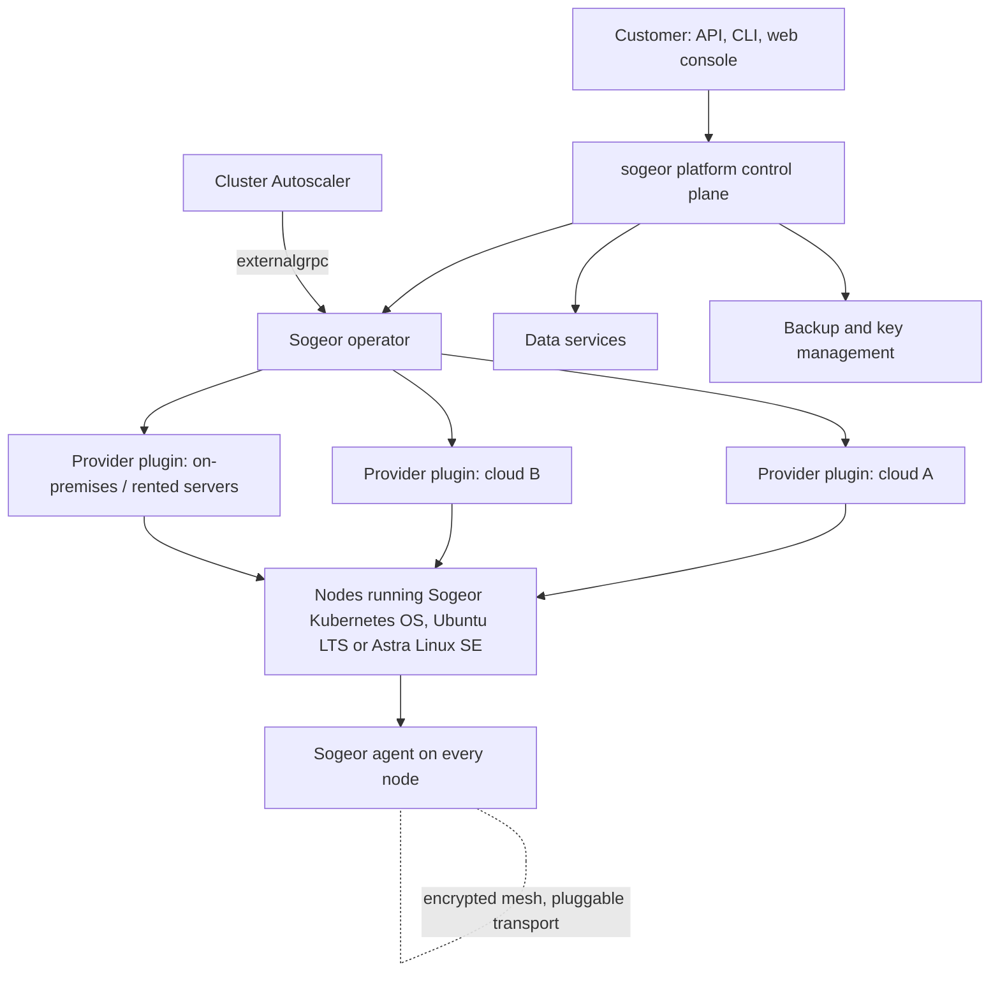

# sogeor platform: vision and roadmap

This document describes where the sogeor platform is going: what it will be, how it will work, which decisions
are already made, what they cost and in which order the work happens. It is written so that someone without
any prior context can read it once and understand the whole direction.

!!! note "Status"
    Vision, accepted on 2026-10-15. The base platform described in the repositories today is the first stage of
    this roadmap; everything else here comes after it works end to end.

## 1. In one paragraph

**Sogeor** builds **sogeor platform**, a Platform as a Service for businesses and individuals around the world.
A customer describes what they need — clusters, node pools in any clouds, databases, backup and placement
rules — and the platform does the rest: it builds and hardens the operating system images, creates and heals the
nodes, runs and upgrades Kubernetes, scales across providers, backs up and restores data. The customer focuses on
their product, not on infrastructure. Sogeor runs its own infrastructure on the same platform.

## 2. Why

Running production Kubernetes well still takes a team: images, hardening, cluster lifecycle, networking between
sites, upgrades, backups, restore drills, security policies, compliance. Existing tools solve parts of this and
usually tie a cluster to one provider:

- Cluster API attaches a cluster to a single infrastructure provider.
- Cloud autoscalers such as Karpenter work inside one cloud.
- Managed Kubernetes services lock both the control plane and the nodes into one vendor.

sogeor platform aims at a cluster that **does not depend on who hosts it**: pools of the same cluster can run in
different clouds, at home or on rented servers, and move between them by changing a description.

## 3. Principles

| Principle | Meaning |
|---|---|
| The platform does almost everything | Customers declare intent; images, hardening, lifecycle, upgrades, backups and recovery are automatic |
| Provider independence | Every pool chooses its provider; nothing above the node layer knows where a node runs |
| The customer decides | Costs, placement, control-plane layout, cryptography profile are the customer's choice; the platform warns and offers limits, but does not forbid |
| Secure by default, minimal attack surface | Images are fully prepared in CI/CD; nodes have no SSH; one authenticated management channel; everything encrypted |
| Rather lose data than leak it — and make losing it nearly impossible | Strong encryption of data and backups, and backups reliable enough that loss is very unlikely |
| Stability over speed | Frequent, carefully tested releases instead of a rolling release; staged rollout with automatic rollback |
| Built on proven pieces | No home-made cryptography; reuse mature open-source building blocks where they fit |
| Gradual delivery | One OS, one provider, one data engine at a time; a working platform early instead of everything at once |

## 4. Where we are today: the base platform

The current repositories of [github.com/sogeor](https://github.com/sogeor) build the base platform:

- a cluster constructor: one validated cluster description, provider modules with a common node contract;
- a management cluster on Talos Linux created with OpenTofu;
- workload clusters created by Cluster API from the management cluster, with autoscaling inside one provider;
- GitOps with Argo CD, OpenBao for secrets, Keycloak, Harbor, backups, policies as code, a supply chain with
  signatures and SBOMs, international and Russian compliance tracks.

The base platform is kept as it is and finished first. It is the foundation and the reference that the future
components will replace step by step. Its provider-neutral contracts (cluster description, node contract) are
the ones the future components use.

## 5. Target architecture

### 5.1. Sogeor operator (Go)

Replaces Cluster API for sogeor clusters.

- **Node pools in any providers within one cluster.** A pool is the unit of placement; each pool has its own
  provider, region, OS, size and limits.
- **Programmable scaling strategies.** Example: under load, add nodes in Yandex Cloud zone `ru-central1-a` first;
  after three nodes there, continue in Selectel. Strategies can express order, limits, prices, zones and data
  residency.
- **Integration with Cluster Autoscaler** through its `externalgrpc` protocol, so standard scaling signals drive the
  operator.
- **Node lifecycle:** creation, health checks, remediation, planned replacement when a new image is released.
- **Provider plugins** behind one interface (create, delete, list machines → the normalized node contract).
- **Cluster description as a Kubernetes resource**, so the constructor works from inside the platform.

Go is chosen because the Kubernetes ecosystem (controller-runtime, client-go, Cluster Autoscaler protocols) is Go.

### 5.2. Control-plane placement

The customer may place control-plane nodes on one site or on several. Kubernetes stores its state in etcd, which
uses the Raft consensus algorithm:

- every write waits until a majority of members persisted it, so every API write costs at least one round trip to
  the nearest majority;
- the leader sends heartbeats (100 ms by default); followers that miss them for the election timeout (1000 ms by
  default) start an election, during which the cluster accepts no writes;
- slow writes make controller leases expire, which causes more restarts and leader changes — a cascade.

This is a trade-off, not a prohibition. With two members close together and one far away, writes are confirmed by
the near majority and the far member only adds resilience; with three far-apart members every write waits for a
distant one. The operator measures latency, warns about poor quorum layouts (for example 1+1+1 across distant
sites) and tunes etcd timers to the measured latency. The decision and its consequences belong to the customer.

### 5.3. Sogeor agent (Rust)

- Preinstalled in every image; the only management channel to a node (no SSH, no interactive shell).
- Minimal work at boot: join the encrypted mesh, join the cluster, report health and compliance state.
- Rust gives memory safety for a privileged component, small static binaries and predictable resource use.

### 5.4. Operating systems

| OS | Role | Notes |
|---|---|---|
| **Sogeor Kubernetes OS** | Main OS of Kubernetes nodes; also a separate Sogeor product for Russia, CIS and the rest of the world | Immutable, only for Kubernetes nodes (like Talos Linux). Built on an existing distribution (Ubuntu or Alpine): dm-verity root, A/B updates with automatic rollback, UKI + SecureBoot + TPM, managed only by the agent. Sogeor does not build its own package distribution |
| **Ubuntu LTS** | General-purpose nodes | Widest compatibility with Kubernetes and clouds; CIS hardening |
| **Astra Linux SE** | Certified Russian OS for the public sector | FSTEC-certified; RED OS may be added on request |
| Talos Linux | Base platform only | Used until Sogeor Kubernetes OS is ready |

Each OS is added one at a time, in the order the platform needs them.

### 5.5. Data services

- One platform interface for databases and data systems: PostgreSQL, Redis, Kafka and others — for example
  "PostgreSQL, three replicas, hourly backup, keep 30 days".
- Engines behind the interface are replaceable. First, adapters to mature open-source operators (CloudNativePG,
  Strimzi and others); then Sogeor's own implementations, engine by engine, where a third-party operator limits
  the platform. Customers keep the same interface throughout.

### 5.6. Backups and keys

- Automatic backups of volumes and databases, retention policies, and regular automated restore tests that
  include the keys.
- Data is encrypted with AES-256 or ChaCha20; data keys are wrapped with a hybrid key encapsulation
  (classical + post-quantum); master keys are split with Shamir's secret sharing between the customer and the
  platform.
- Goal: stolen backups are useless to the thief, and losing data through the platform is very unlikely.

### 5.7. Network

- All traffic between nodes, sites and the platform is encrypted.
- The transport is pluggable: WireGuard, AmneziaWG, others, and a Sogeor protocol built on the Noise Protocol
  Framework. Proven cryptographic constructions only; the Sogeor part is the transport and its resistance to
  blocking, not new cryptography.

### 5.8. Cryptography profiles

| Profile | Algorithms |
|---|---|
| International (default) | Hybrid classical + post-quantum key exchange (X25519 + ML-KEM, FIPS 203), post-quantum signatures where supported (ML-DSA, FIPS 204), AES-256 / ChaCha20 for data |
| Russia, public sector and certified environments | GOST algorithms are mandatory; international algorithms only in combination with GOST, never instead of it |
| Russia, other businesses | The customer chooses GOST, international or hybrid |

The main threat addressed by post-quantum algorithms is "harvest now, decrypt later": traffic and backups stolen
today must stay unreadable when quantum computers become practical.

### 5.9. Multi-tenancy

sogeor platform serves many customers. Clusters, networks, keys, backups, logs and access are isolated per tenant
from the first version of the operator; every action is audited.

## 6. Releases

- Frequent, carefully tested releases of images, the agent and the operator — not a rolling release.
- Staged rollout: one node, then one pool, then everything, with automatic checks and rollback.
- Critical vulnerabilities get an out-of-band release through the same pipeline.

## 7. Alternatives considered

| Option | Why it is not enough on its own |
|---|---|
| Cluster API as is | One infrastructure provider per cluster |
| Karpenter | Excellent scaling, but one cloud provider per installation |
| Gardener | Multi-cloud at the platform level, but each cluster lives in one provider; heavy for a small footprint |
| Omni (Sidero Labs) | Nodes anywhere over KubeSpan, but Talos-only and a commercial product |
| Managed Kubernetes services | Control plane and nodes locked into one vendor |
| Talos Linux | Strong immutable design; too restrictive to be the long-term base of the platform and its products |

## 8. Trade-offs and risks

| Risk | Mitigation |
|---|---|
| Maintenance load of an operator, an agent, an OS and data engines | Build on stable protocols and proven open-source pieces; deliver one component at a time; tests and CI from day one |
| Control plane across sites | Latency measurement, quorum-layout warnings, etcd tuning; the customer decides |
| Traffic between providers costs money and adds latency | Placement and scaling strategies include cost and topology |
| Volumes are tied to a provider | Stateful workloads pinned to a provider or replicated storage, by policy |
| A privileged agent and an operator holding cloud credentials are attractive targets | Least privilege per plugin, keys in a secrets manager, signed artifacts, SLSA provenance, full audit, no inbound management ports |
| Data residency laws | Placement policies (for example "this tenant's data stays in Russia") enforced at admission |
| Upstream drift (Kubernetes, Cluster Autoscaler) | Use only stable interfaces; review upstream regularly |

## 9. Roadmap

| Stage | Content |
|---|---|
| 1. Base platform | Finish the base platform described by the repositories (constructor, management cluster, workload clusters, GitOps, security, backups, Store) |
| 2. Cross-provider prototype | A workload pool in a second provider joined over the mesh; measure latency and traffic cost |
| 3. Sogeor agent | Boot, mesh and cluster join, health and compliance reporting; Ubuntu first |
| 4. Sogeor operator | Node pools in any providers, scaling strategies, Cluster Autoscaler integration |
| 5. One cluster, many providers | Remove the single-provider restriction of the base platform; move the reference clusters |
| 6. Cluster description as a resource | The constructor runs inside the platform |
| 7. Sogeor Kubernetes OS | Immutable node OS on Ubuntu or Alpine; nodes move from Talos; later a separate product |
| 8. Data services | Unified interface with adapters, then Sogeor engines one by one |
| 9. PaaS for customers | Multi-tenant platform for businesses and individuals worldwide |

## 10. Open questions

- Base of Sogeor Kubernetes OS: Ubuntu (compatibility) or Alpine (minimal footprint).
- Which data engine becomes the first Sogeor implementation.
- Repository layout for the operator, the agent, the OS and the CLI.
